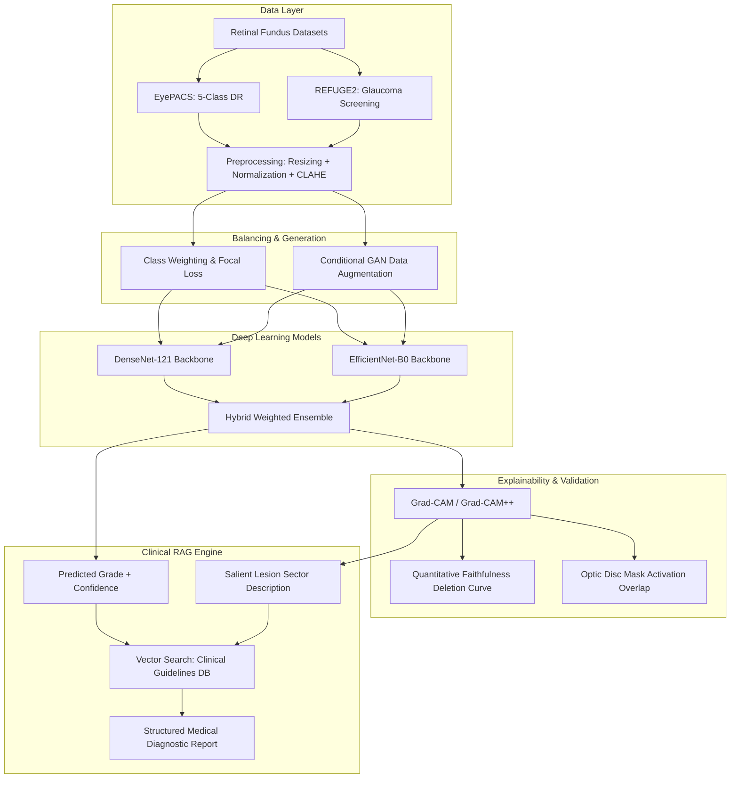

# Explainable Detection of Diabetic Retinopathy and Glaucoma Using Retinal Fundus Images

[](https://opensource.org/licenses/MIT)
[](https://www.python.org/downloads/)
[](https://pytorch.org/)

An end-to-end medical AI research framework for automated grading, explainable visual attribution, generative class balancing, and grounded clinical report generation for retinal diseases (**Diabetic Retinopathy** and **Glaucoma**) using fundus photography.

---

## 👥 Authors & Affiliation
**Department of Computer Science and Engineering**  
**Brac University** (October 2026)

- **Zannatun Nayem** (Student ID: 23301681)
- **Farin Zaman Audri** (Student ID: 23341041)
- **Abu Nayeem Md. Tanzim Adib** (Student ID: 22301019)

**Supervisor:**  
**Annajiat Alim Rasel** (Senior Lecturer, Department of CSE, Brac University)

---

## 📌 Research Overview & Motivation

Diabetic Retinopathy (DR) and Glaucoma are two leading causes of irreversible blindness worldwide. While deep learning convolutional architectures achieve high classification accuracy, clinical adoption in ophthalmology remains hindered by:
1. **Black-box opacity**: Lack of interpretable, medically validated visual rationale.
2. **Extreme class imbalance**: EyePACS exhibits ~73.5% healthy controls and <5% severe/proliferative stages.
3. **Absence of clinical text explanations**: Most state-of-the-art models output only a numeric label or raw heatmap without structured medical reasoning.

This project delivers a multi-disease pipeline that integrates:
- **Transfer Learning Classifiers**: DenseNet-121, EfficientNet-B0, and hybrid ensemble architectures.
- **Class Imbalance Mitigation**: Inverse frequency class weighting, Focal Loss, and Conditional GAN (cGAN) synthetic augmentation.
- **Explainable AI (XAI)**: Grad-CAM and Grad-CAM++ with quantitative faithfulness deletion scoring and optic disc mask activation overlap.
- **Retrieval-Augmented Generation (RAG)**: An evidence-grounded clinical explanation layer querying indexed ophthalmic guidelines (AAO, ICO, EGS, ETDRS).

---

## 🏗️ System Architecture



---

## 📊 Benchmarking & Strategy to Surpass Literature

To address supervisor directives and outperform prior benchmarks reported in our literature review:

| Research Study | Model Architecture | Dataset | Reported Metric | Our Proposed Target |
| :--- | :--- | :--- | :--- | :--- |
| **Gulshan et al. (2016)** | Inception-v3 | EyePACS-1 | 99.1% AUC | **> 99.2% AUC** (Referable DR) |
| **Ting et al. (2017)** | Deep CNN Ensemble | Multiethnic (71K) | 93.6% AUC (DR), 94.2% (Glaucoma) | **> 95.5% AUC** (Dual screening) |
| **Pascal et al. (2022)** | MTL-IO (VGG-16 + U-Net) | REFUGE | 96.76% AUC (Glaucoma) | **> 97.5% AUC** (REFUGE2) |
| **Zhu et al. (2026)** | EfficientNet-B0 + DenseNet-121 | EyePACS + APTOS | 91.2% Acc, 0.961 AUC | **> 92.5% Acc, > 0.965 AUC** |
| **Al-Dolat et al. (2026)** | DenseNet-121 + CBAM | APTOS / DDR | 96.12% Acc | **Surpass via cGAN balancing** |

### Key Unique Contributions
1. **Unified Dual-Disease Pipeline**: Single modular pipeline processing both 5-grade DR and binary Glaucoma.
2. **Quantitative Faithfulness Verification**: Moving beyond qualitative heatmaps to systematic pixel deletion tests and Adebayo sanity checks.
3. **Optic Disc Activation Mass Ratio**: Mathematical evaluation of whether glaucoma Grad-CAM focuses on the optic disc mask in REFUGE2 vs. background.
4. **First Retinal RAG Diagnostic Layer**: Bridging visual deep learning heatmaps directly to clinical management guidelines (ETDRS 4-2-1 rule and EGS guidelines).

---

## 📁 Repository Structure

```
.
├── configs/
│   └── config.yaml               # Central hyperparameter & pipeline configuration
├── scripts/
│   ├── train_dr.py               # Training script for Diabetic Retinopathy models
│   ├── train_glaucoma.py         # Training script for Glaucoma models
│   ├── run_xai.py                # Grad-CAM, Grad-CAM++ & faithfulness tests
│   ├── run_gan.py                # Conditional GAN training & synthetic generation
│   └── run_rag.py                # RAG clinical report generation demonstration
├── src/
│   ├── data/
│   │   ├── eyepacs_dataset.py    # Hugging Face EyePACS loader with CLAHE enhancement
│   │   ├── refuge2_dataset.py    # REFUGE2 / G1020 dataset and mask loader
│   │   └── imbalance.py          # Class weight calculation and weighted samplers
│   ├── models/
│   │   ├── classifiers.py        # DenseNet121, EfficientNet-B0, and RetinalEnsembleModel
│   │   ├── losses.py             # Multi-class Focal Loss and weighted losses
│   │   └── metrics.py            # Accuracy, QWK, AUROC, Sensitivity, Specificity
│   ├── gan/
│   │   └── cgan.py               # Conditional GAN generator, discriminator & trainer
│   ├── xai/
│   │   ├── gradcam.py            # Grad-CAM/Grad-CAM++ and optic disc overlap
│   │   └── faithfulness.py       # Deletion curve test and Adebayo sanity check
│   └── rag/
│       ├── knowledge_docs/       # Curated ophthalmic clinical guidelines (JSON)
│       ├── retrieval.py          # Semantic embedding vector retriever
│       └── report_generator.py   # Evidence-grounded clinical report generator
├── WORK_DONE_SO_FAR.md           # Detailed record of preliminary experiments & milestones
├── requirements.txt              # Environment dependencies
├── .gitignore                    # Excludes datasets, checkpoints, and scratch notebooks
└── README.md
```

---

## 🚀 Getting Started

### 1. Clone and Install Dependencies
```bash
git clone https://github.com/ZANNATUNNAYEM/Explainable-Detection-of-Diabetic-Retinopathy-and-Glaucoma-Using-Retinal-Fundus-Images.git
cd Explainable-Detection-of-Diabetic-Retinopathy-and-Glaucoma-Using-Retinal-Fundus-Images
pip install -r requirements.txt
```

### 2. Train Diabetic Retinopathy Model (5-Class or Referable)
```bash
# Train DenseNet-121 with Focal Loss
python scripts/train_dr.py --arch densenet121 --epochs 10 --batch_size 16 --loss focal

# Train EfficientNet-B0 for binary referable DR
python scripts/train_dr.py --arch efficientnet_b0 --epochs 10 --referable
```

### 3. Generate XAI Visual Explanations & Faithfulness
```bash
python scripts/run_xai.py --arch densenet121 --method gradcam
```

### 4. Run Conditional GAN Synthetic Augmentation
```bash
python scripts/run_gan.py --num_classes 5 --output_dir results/gan_samples
```

### 5. Generate Grounded Clinical Decision Support Report (RAG)
```bash
python scripts/run_rag.py --disease "Diabetic Retinopathy" --grade "Severe NPDR (Grade 3)" --conf 0.94
```

---

## 📄 License
This repository is released under the [MIT License](LICENSE).
